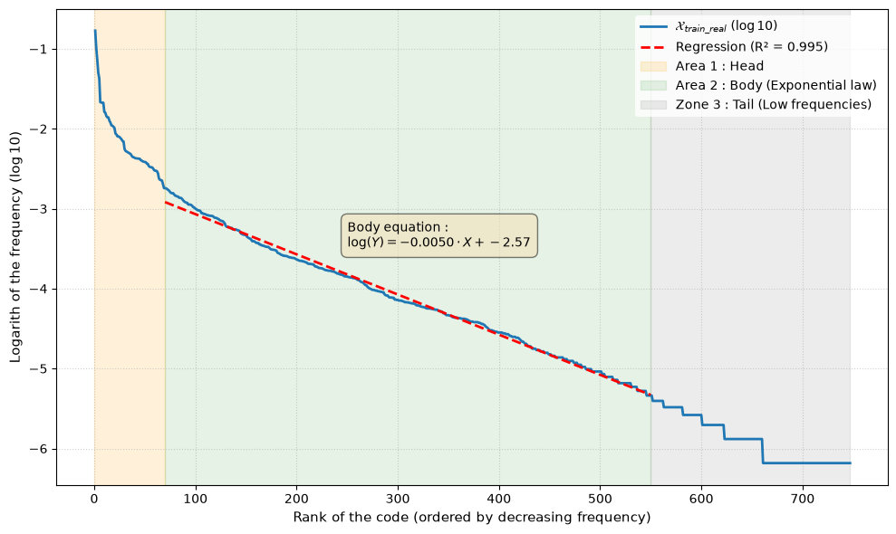
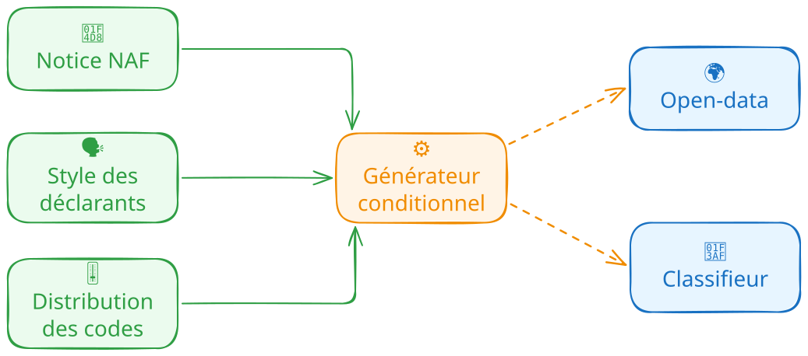
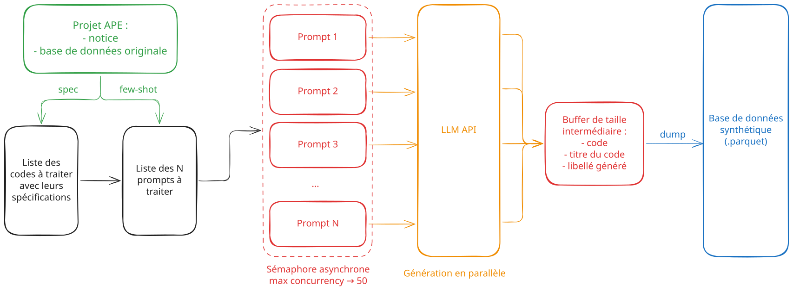
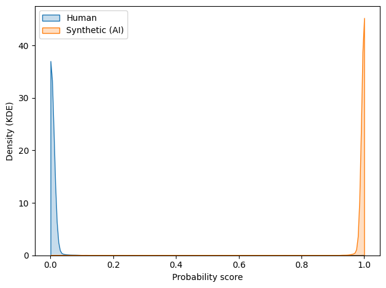
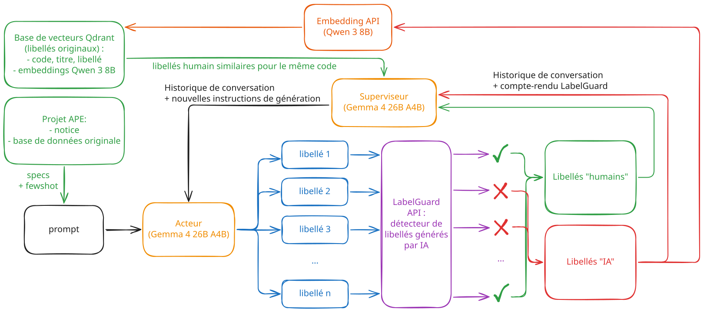
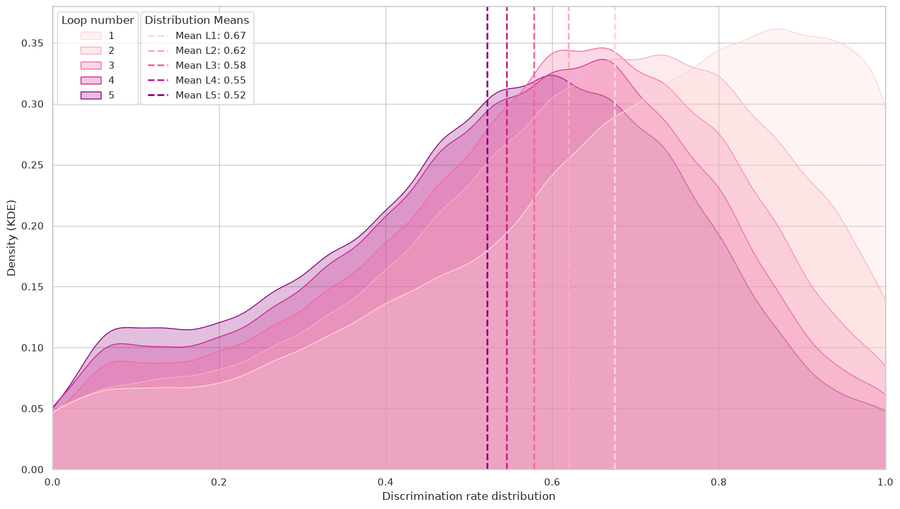
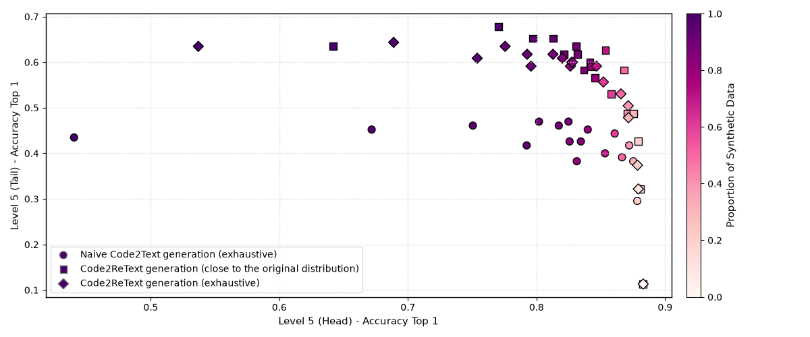
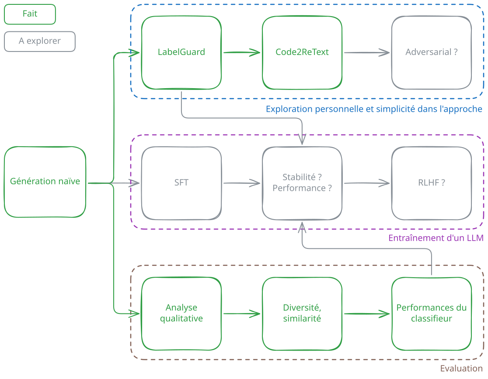

## Plan

1. **Contexte et enjeux**
2. **Méthodologie**
3. **Résultats**
4. **Compétences acquises**
5. **Limites & perspectives**

# 1. Contexte et enjeux {.section-slide .center-text background-color="#1b2a49"}

---

## A l'origine : coder l'activité des entreprises

NAF : Nomenclature d'Activité Française (= code APE)

::: {.columns}
::: {.column width="40%"}
::: {.stat-row}
::: {.stat}
[747]{.val}
[classes dans la NAF 2025]{.lbl}
:::
::: {.stat .teal}
[> 1 M]{.val}
[libellés réels d'entraînement]{.lbl}
:::
::: {.stat}
[1 code sur 2]{.val}
[a moins de 60 exemples]{.lbl}
:::
:::

- **Text2Code** : libellé libre → code NAF
- **Aujourd'hui** : FastText, ~70 % des cas codés seuls

::: {.box}
**Objectif principal** : enrichir l'entraînement par des données synthétiques issues de grands modèles de langage (LLMs)
:::
:::
::: {.column width="60%" .center-text}
{#fig-code-log-freq fig-alt="Distribution des codes dans $\mathcal{X}_{train\_real}$, composée d'une tête à très haute fréquence (jusqu'à 10%), d'un corps qui suit une loi exponentielle, et d'une queue sous forme de marches (très faibles proportions) mais avec tendance globale la même équation que le corps."}
:::
:::

---

## Informations sur la donnée originale

:::{style="display: flex; flex-direction: column; gap: 20px; font-size: 0.8em"}
::: {.box}
[La base de données est large]{.box-title}

- **Train** ≈ 1,5 M d'observations
- **Validation** ≈ 400 k
- **Test** ≈ 500 k
:::
::: {.box .bad}
[La base de données est bruitée]{.box-title}

- **FastText** : ~10 % d'erreur sur les deux tiers de données traités
- **Gestionnaires** : potentiels bruits non mesurés sur le tier restant
- **Recodage** NAF 2008 → 2025 par LLM
- **Altération artificielle** de la distribution (~mai 2026)
- **Troncature des libellés** : 8 % à 141 ou 161 caractères
:::
:::

# 2. Méthodologie {.section-slide  .center-text background-color="#1b2a49"}

---

## L'idée : découpler structure et expression

**Un seul générateur**, deux usages selon la loi d'échantillonnage :

::: {.center-text}
{width=80%}
:::

---

## 1️⃣ NaiveCode2Text : la génération initiale

:::{.center-text}
{#fig-naive-parallel fig-alt="Schéma du pipeline NaiveCode2Text avec requêtes parallèles" width=80%}
:::
::: {.box .bad style="font-size:0.6em;"}
- Ton **trop professionnel**
- Phrases **sans faute**
- Proche du **titre** du code
:::

---

## 2️⃣ LabelGuard : mesurer l'empreinte du LLM

::: {.columns}
::: {.column width="50%"}
::: {.stat .teal}
[4096 → 1]{.val}
[MLP sur embeddings Qwen3-8B]{.lbl}
:::
::: {.stat-row}
::: {.stat}
[99,4 %]{.val}
[exactitude (sur 40 000 libellés)]{.lbl}
:::
::: {.stat}
[0,7 %]{.val}
[faux positifs (soit 139 libellés)]{.lbl}
:::
:::
- **Discriminateur** humain (0) ou IA (1)
- Un **watermark** (signature stylistique du LLM) est présent
- **Robuste** : le modèle prédit correctement même avec peu de données d'entraînement.

::: {.box .bad}
**En l'état, le style du LLM est trop éloigné du style orginal**
:::

:::

::: {.column width="50%" .center-text}
{#fig-labelguard-confidence fig-alt="Deux grands pics de confiance sont présents autour de 0 et de 1 avec une prédiction correcte."}
:::
:::

---

## 3️⃣ Code2ReText : boucle Acteur-Superviseur

::: {.center-text}
{#fig-retext fig-alt="Schéma Code2ReText"}
:::

---

## 3️⃣ Code2ReText : évolution de la discrimination au fil des boucles

::: {.center-text}
{#fig-error-rate-evolution width="65%"}
:::

---

## Naive vs Code2ReText : exemples

| Titre du code | NaiveCode2Text | Code2ReText |
|:--|:--|:--|
| Commerce de gros, plomberie et chauffage | Commerce interentreprises de matériel de chauffage industriel. | Plomberie chauffage |
| Travaux de génie civil spécialisés | Construction d'ouvrages d'art complexe. | MONTAGE STRUCTURES METALLIQUES POUR GENIE CIVIL |
| Conseil pour les affaires | Prestation de services de conseil en organisation | CONSEIL GESTION |

✅ **Style** : plus brut, plus proche de la donnée originale

⚠️ **Parfois** : copie des exemples few shot (surtout si un seul exemple dans le code)

---

## 4️⃣ Évaluation finale : protocole $\mathcal{M}_\alpha$

:::{style="font-size: 0.8em"}
**Evaluation d'un classifieur Text2Code** selon des datasets d'entraînement $\mathcal{M}_\alpha$ différents :

$$\mathcal{M}_\alpha = \mathcal{C}_{real}(\alpha) \cup \mathcal{C}_{synth}(\alpha), \quad |\mathcal{M}_\alpha| = 50\,000$$

- **α** : part de données synthétiques injectée
- **Ensembles imbriqués** :

:::{.center-text}
$$ {\alpha}_1 < {\alpha}_2 \Longrightarrow \mathcal{C}_{real}({\alpha}_2) \subset \mathcal{C}_{real}({\alpha}_1), \quad \mathcal{C}_{synth}({\alpha}_1) \subset \mathcal{C}_{synth}({\alpha}_2)$$
:::

- **Base immuable** : 1 exemple par code (747)
- **Même architecture** : hyperparamètres figés (grid search 36 configs)

::: {.box}
On applique la méthode pour différents $\mathcal{C}_{real}(\alpha)$ issus de NaiveCode2Text et Code2ReText
:::
:::

# 3. Résultats {.section-slide  .center-text background-color="#1b2a49"}

---

## Résultats à retenir

::: {.columns}

::: {.column width="40%"}
::: {.stat-row}
::: {.stat .teal}
[40–50 %]{.val}
[taux d'injection optimal]{.lbl}
:::
::: {.stat}
[87 % / 60 %]{.val}
[accuracy tête / queue à α = 0,4]{.lbl}
:::
::: {.stat .teal}
[α ≥ 0,9]{.val}
[effondrement des performances]{.lbl}
:::
:::

- **Queue de dsitribution** : gain très net dès les premières injections
- **Tête et corps** : peu dégradés à 40–50 %
- **Meilleur choix** : Code2ReText, distribution proche de l'originale
- **Moins de diversité** avec Code2ReText
:::

::: {.column .center-text width="60%"}
{#fig-lvl5-head-acc-top1-tail-acc-top1 fig-alt="Tendance décroissante concave générale, compromis autour de $\alpha = 0.4$ (87%/60%)"}
:::

:::

::: {.box}
L'injection de données synthétiques **réduit la discrimination** des classes rares
:::

# 4. Compétences acquises {.section-slide  .center-text background-color="#1b2a49"}

---

## Compétences acquises

:::: {.columns style="display: flex !important; align-items: center;"}

::: {.column width="50%"}
::: {#fig-environnement fig-cap="Architecture de l'environnement informatique disponible"}
<iframe
  src="../sources/interactive/environnement_informatique.html"
  class="interactive-figure"
  title="Environnement informatique disponible"
  width="100%"
  height="550px">
</iframe>
:::
:::

::: {.column width="50%" style="display: flex; justify-content: center; flex-direction: column;"}
| Compétence | Outils mobilisés |
|:--|:--|
| **LLM & API** | vLLM, NVIDIA H100, `asyncio` |
| **Agentique** | LangChain, **LangGraph** |
| **Observabilité** | **Langfuse** (tracing) |
| **Orchestration** | **Argo Workflows**, Argo CD |
| **Données & infra** | Kubernetes, MinIO/S3, Qdrant, Neo4j |
| **Reproductibilité** | Git, conteneurs |
:::
::::

# 5. Limites et perspectives {.section-slide .center-text background-color="#1b2a49"}

---

## Limites

::: {.stat-row}
::: {.stat}
[0,5 %]{.val}
[libellés recopiés par ReText (Naive : 0,005 %)]{.lbl}
:::
::: {.stat}
[50 k]{.val}
[données d'entraînement pour le benchmark]{.lbl}
:::
:::

- **Fuite de données** : risque pour l'open-data
- **Bruit** des annotations et du changement de nomenclature
  - Mais robustesse des résultats pour le niveau 4 et pour le top 5 des prédictions 
- **Style encore imparfait** : bruit humain pas entièrement assimilé
  - Souvent un seul trait qui est exacerbé
- **Comparaison** avec des méthodes simples
  - Ajout de fautes d'orthographes, recopier les libellés pour les codes rares, ...

---

## Perspectives

:::: {.columns style="display: flex !important; align-items: center;"}
::: {.column .center-text width="50%" style="display: flex; justify-content: center; flex-direction: column;"}
{#fig-etat-des-lieux}
:::
::: {.column  style="font-size: 0.9em"}
[Autres méthodes à explorer]{.box-title}

- **SFT** : Supervised Fine Tuning
  - objectif : imiter les bons styles de générations à partir des données originales
  - limites : sur-apprentissage des grandes classes et instabilité
- **RLHF** (Reinforcement Learning from Human Feedback)
  - objectif : guider le style par un retour humain (ou LLM as a judge)
  - possibilité d'inclure LabelGuard dans l'évaluation
  - limite princiaple : instabilité

[Open source et reproductibilité]{.box-title}

- **NACE** : généraliser le générateur pour les services statistiques européens
  - requiert une base européenne d'exemples
- **Multilingue** : réussir à adapter selon la langue
  - Simple si méthode actuelle, difficile autrement
:::
:::
